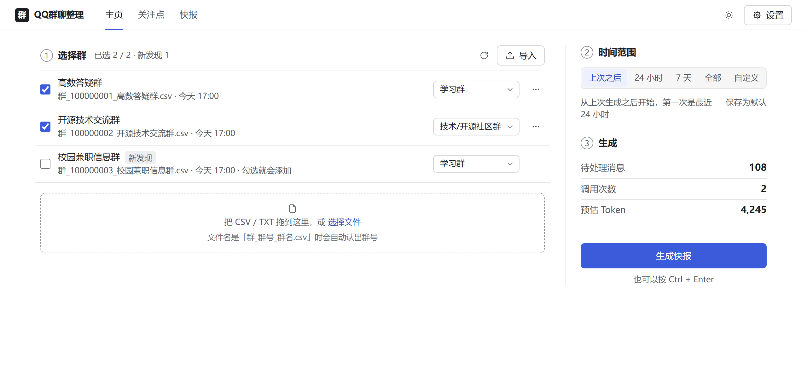

<div align="center">

# qq-group-digest

Use AI to pick out what matters to you from QQ group chats, as a daily or weekly digest.

**English** · [简体中文](README.zh-CN.md)

[](https://github.com/Eutopia-Nan/qq-group-digest/releases/latest)

[](LICENSE)

</div>

<picture>
  <source media="(prefers-color-scheme: dark)" srcset="docs/images/home-dark.png">
  
</picture>

## Features

- **Filtered for you**: picks out exam notices, study materials, gigs and internships based on your profile, and says whether you qualify for opportunities
- **Traceable**: every item cites the original message, sender and time; jargon is explained in plain words
- **Predictable cost**: estimates messages and tokens before running and only processes new messages by default; a day of chat usually costs a few cents of a yuan
- **Desktop app**: unzip and run on Windows, no Python needed; a cross-platform command line is included
- **Any model**: DeepSeek, other OpenAI-compatible endpoints, or a local Ollama

> The interface, prompts and digests are in Chinese, since the tool is built for Chinese-language QQ groups.

## Quick start

1. Download the Windows zip from [Releases](https://github.com/Eutopia-Nan/qq-group-digest/releases/latest), unzip it and double-click `qq-group-digest.exe` (if SmartScreen warns you, choose **More info → Run anyway**)
2. Enter the AI endpoint and API key in the first-run setup
3. Export your group chats to CSV (see [Export chat records](docs/usage.md#export-chat-records)) and drag the files into the window
4. Tick the groups, pick a time range and click **生成快报** (generate digest)

**Command line** (macOS / Linux, Python 3.8+, no dependencies):

```bash
git clone https://github.com/Eutopia-Nan/qq-group-digest.git
cd qq-group-digest
cp config.example.json config.json   # fill in api_key, profile and groups
python digest.py --preset daily
```

## Docs

- [Usage guide](docs/usage.md): exporting chats, everyday use, command line, all config options
- [FAQ](docs/faq.md)
- [Contributing](CONTRIBUTING.md)

## Privacy

- The selected chat text, sender names and your profile are sent to the AI provider you configure; with a local Ollama nothing leaves your computer
- Your API key, config and digests are stored only on your machine
- The AI can miss or misread things; check important details against the original messages

## Disclaimer

This project is not affiliated with Tencent; "QQ" is a Tencent trademark. It only analyzes chat export files that you produce yourself and contains no code for fetching or decrypting QQ data or connecting to any QQ protocol. Only process chats you are entitled to view and follow applicable laws and platform terms; you are responsible for how you use it.

## License

[MIT](LICENSE) © Eutopia · Built with AI assistance
