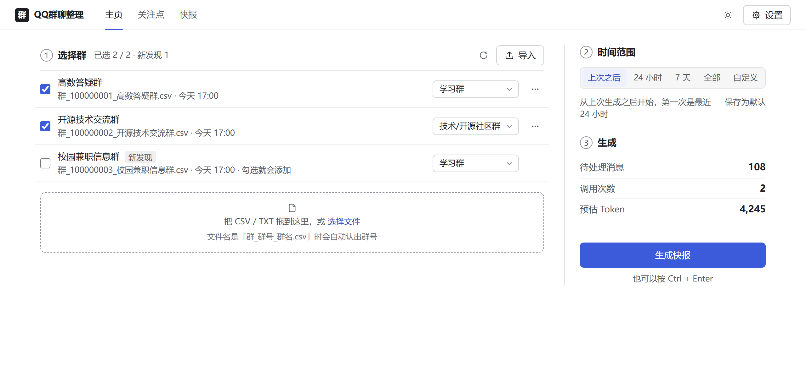

<div align="center">

# qq-group-digest

用 AI 从 QQ 群聊记录里挑出对你有用的信息，整理成每日 / 每周快报。

[English](README.md) · **简体中文**

[](https://github.com/Eutopia-Nan/qq-group-digest/releases/latest)

[](LICENSE)

</div>

<picture>
  <source media="(prefers-color-scheme: dark)" srcset="docs/images/home-dark.png">
  
</picture>

## 功能

- **按你的情况筛选**：根据你的身份和需求挑出考试通知、学习资料、兼职实习等信息，机会类信息会说明你能不能参加
- **有据可查**：每条信息附原文、发送者和时间，术语用大白话解释
- **花费可控**：生成前预估消息数和 Token，默认只处理新消息，一天通常几分钱
- **图形界面**：Windows 解压即用，不需要 Python；也有跨平台的命令行版
- **模型随你选**：DeepSeek、其他 OpenAI 兼容接口或本机 Ollama

## 快速开始

1. 到 [Releases](https://github.com/Eutopia-Nan/qq-group-digest/releases/latest) 下载 Windows 版 zip，解压后双击 `qq-group-digest.exe`（提示「已保护你的电脑」时点 **更多信息 → 仍要运行**）
2. 在首次设置里填好 AI 接口和 API Key
3. 用导出工具把群聊导出成 CSV（见[导出群聊记录](docs/usage.zh-CN.md#导出群聊记录)），拖进窗口
4. 勾选群、选时间范围，点 **生成快报**

**命令行版**（macOS / Linux，需要 Python 3.8+，无需安装依赖）：

```bash
git clone https://github.com/Eutopia-Nan/qq-group-digest.git
cd qq-group-digest
cp config.example.json config.json   # 填写 api_key、profile 和 groups
python digest.py --preset daily
```

## 文档

- [使用说明](docs/usage.zh-CN.md)：导出聊天记录、日常使用、命令行、全部配置项
- [常见问题](docs/faq.zh-CN.md)
- [参与贡献](CONTRIBUTING.md)

## 隐私

- 筛选后的聊天文字、发送者昵称和你的个人情况会发给你配置的 AI 服务商；用本机 Ollama 则不出电脑
- API Key、配置和快报都只保存在本地
- AI 可能看漏或理解错，重要信息请以原消息为准

## 免责声明

本项目与腾讯公司无关，「QQ」是腾讯公司的商标。本项目只分析用户自行导出的聊天记录文件，不包含任何获取、解密 QQ 数据或接入 QQ 协议的功能。请仅处理你有权查看的聊天记录，并遵守相关法律法规和平台协议，使用后果由使用者自行承担。

## 许可证

[MIT](LICENSE) © Eutopia · 本项目在 AI 辅助下开发
