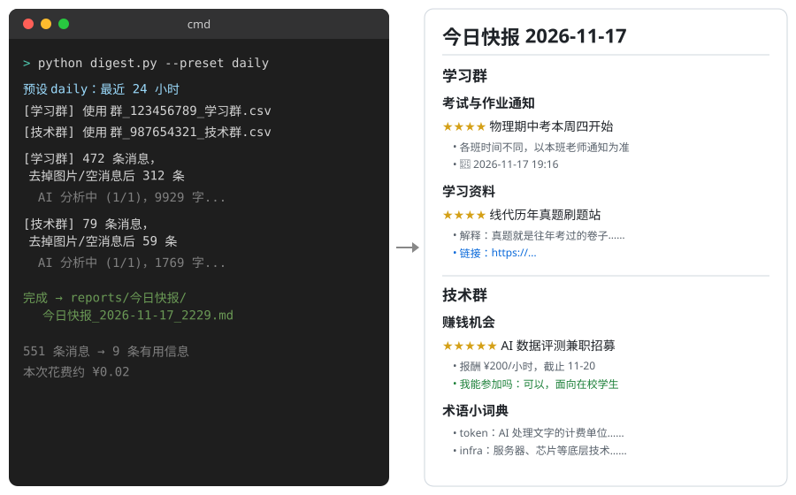

# qq-group-digest

[English](README.md) | **简体中文**

> 用 AI 从 QQ 群聊记录里筛出对你有用的信息，自动生成每日/每周快报。




## 目录
- [功能特性](#功能特性)
- [两种上手方式](#两种上手方式)
- [快速开始](#快速开始)
- [使用方法](#使用方法)
- [配置](#配置)
- [项目结构](#项目结构)
- [常见问题](#常见问题)
- [贡献](#贡献)
- [免责声明](#免责声明)
- [许可证](#许可证)

## 功能特性

- 从 QQ 群聊记录中筛选考试通知、学习资料、实习兼职等信息，按需设置关注内容。
- 根据个人情况判断机会是否适合，解释相关术语。
- 生成每日或每周 Markdown 快报，附原文摘录和消息时间。
- 支持 CSV、TXT 和 OpenAI 兼容接口，只用 Python 标准库。

## 两种上手方式

| | 适合谁 | 怎么做 |
|---|---|---|
| **方式 A：手动操作** | 想自己弄清楚每一步 | 按下面的[快速开始](#快速开始)和[使用方法](#使用方法)一步步操作，大约 10 分钟 |
| **方式 B：交给 AI Agent 自动配置** | 电脑上有能执行命令的 AI 助手（如 Claude Code、Codex、Cursor 等） | 复制下面整段提示词发给它，它会边问你边完成配置 |

<details>
<summary><b>方式 B：复制这段提示词发给你的 Agent</b>（点击展开）</summary>

```text
请帮我在这台电脑上安装并配置开源项目 qq-group-digest：
https://github.com/Eutopia-Nan/qq-group-digest

它会读取我自己导出的 QQ 群聊记录文件，用 AI 筛选出对我有用的信息，生成每日/每周快报。
请先阅读仓库里的 README.zh-CN.md 和 config.example.json，再按下面的步骤操作。
请用我的语言和我交流，每次只问一个问题，用通俗的话解释，不要假设我懂编程。

【步骤】
1. 检查 Python 版本是否 >= 3.8。没有的话，告诉我怎么安装（Windows 要勾选 "Add python.exe to PATH"），不要替我静默安装。
2. 问我想把项目放在哪个文件夹，然后下载或 git clone 到那里。
3. 运行自检：python digest.py --file examples/study.csv --type study --all --dry-run ，确认能正常运行。
4. 复制 config.example.json 为 config.json，然后逐项问我并填写：
   - AI 服务：用 DeepSeek（需要 API Key，要先在 platform.deepseek.com 充值），还是其他 OpenAI 兼容接口或本地模型（如 Ollama）。
   - profile：问我的身份、专业或年级、能力水平、最想从群里得到什么（比如考试通知、兼职、实习、技术动态），整理成一段话。
   - groups：问我要筛选哪些群，以及每个群的群号和用途。
   - topics：根据每个群的用途，帮我设计分类。能用现成的 study / opensource 就直接用；不合适就新建类型，并和我确认分类。
   - explain_style：问我需不需要术语解释、解释到什么程度。
   - export_dir：问我导出的聊天记录放在哪里。
   每次修改后都要验证 config.json 是合法的 JSON。
5. 在导出文件夹里，按文件名（群_<群号>_*.csv / *.txt）确认每个群都有导出文件，并告诉我缺哪些。
6. 运行 python digest.py --preset daily --dry-run ，把结果用一两句话告诉我。
7. 告诉我日常怎么用：先重新导出聊天记录，再双击 1_今日快报_24小时.bat 或 2_今周快报_一周.bat。

【必须遵守】
- API Key 只写进本地的 config.json，不要在回复里完整显示，也不要提交或上传到任何地方。config.json 已在 .gitignore 里，不要改动这一点。
- 本项目只处理已经导出的文件。不要自己去读取、解密 QQ 的数据库或进程内存。也不要在我没有明确同意的情况下下载、安装或运行任何第三方导出工具。如果我还没有导出文件，只需告诉我有哪些选择和各自的风险，由我决定。
- 不要打开或复述我的聊天记录内容。确认导出文件时只看文件名、大小、修改时间。
- 真正调用 AI 会产生费用。在我明确同意之前，只运行带 --dry-run 的命令。
- 不要修改 digest.py。遇到报错，先把报错原文和你的判断告诉我。
```

</details>

## 快速开始

### 环境要求
- Python >= 3.8（安装时务必勾选 **"Add python.exe to PATH"**）
- 生成云端快报需要 [DeepSeek API Key](https://platform.deepseek.com) 或其他兼容服务的 Key。下面的样例试运行无需 Key
- 导出好的群聊记录（见[第 2 步](#第-2-步导出群聊记录)）

### 安装
**方式一（推荐新手）**：在本页面点绿色的 **Code** 按钮 → **Download ZIP**，解压到一个好找的位置，比如 `D:\qq-group-digest`。

**方式二**：用 git
```bash
git clone https://github.com/Eutopia-Nan/qq-group-digest.git
cd qq-group-digest
```

无需安装任何依赖。

想先确认安装是否成功？在解压后的项目文件夹地址栏输入 `cmd` 并回车，然后运行：

```bash
python digest.py --file examples/study.csv --type study --all --dry-run
```

终端会显示窗口内 2 条、待处理 1 条。筛选后的示例原文保存在 `raw/`。

## 使用方法

### 第 1 步：填写配置
1. 在项目文件夹里复制 `config.example.json`，把副本**重命名为 `config.json`**
   > Windows 默认隐藏文件扩展名，改名时容易变成 `config.json.json`。建议先在资源管理器顶部点 **查看 → 显示 → 文件扩展名** 把它打开。
2. 用记事本或 VS Code 打开 `config.json`，至少改这三处：

| 要改的地方 | 怎么填 |
|---|---|
| `"api_key": "sk-xxx（...）"` | 把引号里的**整段内容**换成你的 Key |
| `"profile": "【必填】..."` | 换成你自己的情况，越具体筛得越准 |
| `"groups"` | `id` 填群号，`name` 填群名（随意写），`type` 填 `study` 或 `opensource` |

**群号在哪看**：QQ 群聊 → 右上角"群聊设置"，群名称下面那串数字就是群号。导出的文件名里也有。

**编辑时注意**（写错了程序会提示第几行出错）：
- 只改**引号里面**的内容，引号本身要保留
- 用英文标点：英文双引号 `"`、英文逗号 `,`、英文冒号 `:`
- 列表中每两项之间要有逗号，**最后一项后面不能有逗号**
- 内容里不要再出现英文双引号，需要的话用「」代替
- 写路径时，`\` 要写成 `\\` 或 `/`，例如 `"D:/QQ导出"`

### 第 2 步：导出群聊记录
本项目**只处理已经导出的文件**，不包含任何获取、解密聊天记录的功能。你可以用任何能导出聊天记录的工具，例如第三方工具 [qq-chat-exporter](https://github.com/Yosooiiii/qq-chat-exporter)（作者 Yosooiiii，MIT 许可，与本项目无关）。用它导出时选 **CSV** 格式，里面带发言人昵称。使用第三方工具前请自行评估其风险。

- 该导出器的 Windows 免安装版在[发布页](https://github.com/Yosooiiii/qq-chat-exporter/releases)。选发行附件 `QQChatExporter_v1.0.0.zip` 或更新版本对应的应用压缩包。导出时 QQ 需要运行并登录对应账号
- 默认导出到 `桌面\QQ聊天记录导出\`，文件名形如 `群_<群号>_<群名>.csv`。程序按群号查找，同格式取修改时间最新的文件。同一批导出中优先用 CSV
- 导出位置不在桌面的话，在 `config.json` 的 `export_dir` 填上那个文件夹的路径
- 其他工具导出的文件也可以用，见[支持的聊天记录格式](#支持的聊天记录格式)

> 请仅导出你本人账号、你有权查看的聊天记录，并遵守相关法律法规和平台协议。

### 第 3 步：生成报告
双击：
- `1_今日快报_24小时.bat`：最近 24 小时，报告存到 `reports\今日快报\`
- `2_今周快报_一周.bat`：最近 7 天，报告存到 `reports\今周快报\`

报告是 `.md` 文件，运行完会自动打开。用记事本就能看，用 VS Code、Typora 或 Obsidian 打开排版更好。

### 日常使用
**每次都要先重新导出，再运行**，因为本工具不会自己去 QQ 里拿新消息：

1. 用导出工具重新导出（覆盖旧文件即可）
2. 双击 `.bat` 生成报告
3. 需要清理明文时，也检查试运行或启用 `save_raw` 时生成的 `raw/` 副本。报告可能包含聊天摘录

### 命令行参数
```bash
python digest.py --preset daily      # 今日快报（同双击 1）
python digest.py --preset weekly     # 今周快报（同双击 2）
python digest.py                     # 增量处理尚未生成快报的消息，首次回看 24 小时
python digest.py --hours 72          # 最近 3 天
python digest.py --dry-run           # 预览并保存原文，不调用 AI
python digest.py --group 123456789   # 只处理一个群
python digest.py --file 文件.txt --type study   # 处理任意一个聊天记录文件
python digest.py --file 文件.csv --encoding gb18030 --dry-run   # 预览 GBK / GB18030 导出
python digest.py --all               # 处理全部历史记录（很费钱，慎用）
```

## 配置
所有设置都在 `config.json` 里：

| 字段 | 说明 | 默认值 |
|------|------|--------|
| `deepseek.api_key` | 当前 AI 接口的 Key。官方 DeepSeek 地址也可用 `DEEPSEEK_API_KEY` | 云端服务通常需要 |
| `deepseek.base_url` | AI 接口地址，任何 OpenAI 兼容接口都可以 | `https://api.deepseek.com` |
| `deepseek.model` | 模型名，旧配置中的 `deepseek-chat` 和 `deepseek-reasoner` 需更新 | `deepseek-flash` |
| `deepseek.json_mode` | 是否要求接口启用 JSON 模式。关闭后仍校验返回的 JSON | `true` |
| `deepseek.chunk_chars` | 每批用户消息的字符上限。用小上下文模型时可以调低 | `40000` |
| `deepseek.max_tokens` | 每批模型输出的 token 上限 | `4096` |
| `profile` | 你的身份、能力和需求，帮助模型判断什么对你有用 | 无 |
| `explain_style` | 术语解释的风格。留空 `""` 就不解释 | 零基础，大白话 + 生活类比 |
| `topics` | 群类型，以及每类群的关注点和分类（见下文） | `study`、`opensource` |
| `groups` | 要筛选的群：`id` 群号、`name` 群名、`type` 群类型 | 无，必填 |
| `export_dir` | 导出文件所在的文件夹 | `桌面\QQ聊天记录导出` |
| `report_dir` | 不用预设时报告的保存位置 | `reports` |
| `presets` | 预设的时间范围（`hours`）、标题和保存位置 | `daily` 24 小时、`weekly` 168 小时 |
| `open_report` | 运行完是否自动打开报告 | `true` |
| `save_raw` | 正式运行时是否保留筛选后的明文。试运行始终保留预览 | `false` |

内置群类型和预设可按字段覆盖。修改分类时可以只填新增或修改的分类，设为 `{}` 可清除内置分类。自定义预设需填正数 `hours`，也可以在命令行用 `--hours` 或 `--all` 指定范围。

升级后，旧 `state.json` 会在首次成功生成增量报告时转为消息级记录。旧版只保存运行时间，升级后的首次增量可能再次收录部分近期消息。`--hours`、`--preset daily`、`--preset weekly` 和 `--all` 不更新增量进度。

### 自定义群类型
在 `topics` **原有的大括号里面**加一项，和 `study`、`opensource` 并列（前一项末尾要补逗号）：
```json
"topics": {
  "study": { ...原有内容，不要删... },
  "opensource": { ...原有内容，不要删... },
  "job": {
    "label": "求职交流群",
    "focus": "招聘、内推和求职经验",
    "categories": {
      "内推机会": "公司、岗位、要求、截止时间、内推码或联系方式",
      "面经": "面试题目、流程、薪资信息"
    }
  }
},
```
然后把对应群的 `type` 写成 `"job"`。

- `label`：群的描述
- `focus`：这类群里你最关心什么
- `categories`：分类名 → 这个分类收集什么
- 不需要写"其他有用"分类，程序会自动补上
- 正在使用的类型不要删；类型不存在时，程序会在调用 AI 之前就报错，不会白花钱

### 换成其他 AI
把 `base_url`、`model` 和 `api_key` 改为当前服务的配置。使用本机 Ollama 时可填 `"base_url": "http://localhost:11434/v1"` 和已下载的模型名，如 `"model": "qwen2.5"`，并清空 `api_key`。接口不支持 `response_format` 时，在 `deepseek` 里设 `"json_mode": false`。

### 支持的聊天记录格式
| 格式 | 示例 |
|---|---|
| CSV（推荐） | 表头包含时间列（`时间`/`日期`/`time`/`date`）和内容列（`内容`/`消息`/`content`/`message`），发送者列（`发送者`/`昵称`/`sender`/`name`）可选 |
| 单行 TXT | `[2026-11-17 14:03:00] 张三: 内容`（冒号中英文都可以，秒可以省略） |
| 经典版 QQ 消息管理器 TXT | 一行 `2026-11-17 14:03:00 张三(123456)`，下一行是内容 |
| 其他纯文本 | 无法按时间筛选时，使用 `--all` 确认处理整份文件 |

CSV 支持逗号、分号和 Tab 分隔。时间可用本地日期和时间、带时区的 ISO 8601 或 10/13 位时间戳。默认识别 UTF-8 和带 BOM 的 UTF-16，GBK 导出可指定 `--encoding gb18030`。

## 项目结构
```
├── digest.py                 # 主程序
├── config.example.json       # 配置模板（复制为 config.json 后填写）
├── 1_今日快报_24小时.bat      # 双击生成今日快报
├── 2_今周快报_一周.bat        # 双击生成今周快报
├── docs/                     # 文档图片
├── reports/                  # 生成的报告（运行后出现，不上传）
├── raw/                      # 试运行或显式开启时保留的原文（Git 默认忽略）
└── state.json                # 增量处理进度（Git 默认忽略）
```

## 常见问题
| 看到的提示 | 原因和解决方法 |
|---|---|
| `'python' 不是内部或外部命令` / 弹出微软商店 | Python 没装好或没加入 PATH。重新运行 Python 安装程序，选 Modify 并勾选 "Add python.exe to PATH" |
| `config.json 第 X 行格式有误` | 按提示检查那一行，常见是多了或漏了逗号、用了中文引号 |
| `没找到导出文件` | 还没导出；或者导出位置不在桌面，需要设置 `export_dir`；或者群号填错了 |
| `可能需要先重新导出` | 导出文件里没有这段时间的消息，先重新导出 |
| `401` / `402` | API Key 填错了 / 账户余额不足 |
| 报告里写"没有筛出有用信息" | 有新消息，但 AI 判断都是闲聊。可以把 `profile` 和 `categories` 写得更具体 |
| `没有待处理的文本消息` | 窗口内没有可处理文本，或增量模式已经处理过这些消息。可先重新导出或试用 `--hours 72` |

**已知限制**
- 消息很多时会分批交给 AI，不同批次之间可能出现重复条目
- `.bat` 只适用于 Windows；macOS/Linux 用 `python3 digest.py --preset daily`
- AI 可能看漏或理解错，考试时间、截止日期等重要信息请以原消息为准

聊天记录、发送者和你的画像会发给配置的 AI 服务商。Git 默认忽略 `config.json`、`state.json`、`reports/` 和 `raw/`。如果自定义报告目录，分享仓库前也请检查该目录。

## 贡献
欢迎提交 Issue 和 PR！请先阅读 [CONTRIBUTING.md](CONTRIBUTING.md)。

1. Fork 本仓库
2. 新建分支 `git checkout -b feature/xxx`
3. 提交 `git commit -m 'Add xxx'`
4. 推送 `git push origin feature/xxx`
5. 发起 Pull Request

## 免责声明
- 本项目是独立的开源项目，与腾讯公司无关，也未获得其授权或认可。"QQ"是腾讯公司的商标，本项目中仅用于说明适用场景。
- 本项目只对用户自行导出的聊天记录文件做文本分析，不包含任何获取、破解、解密 QQ 数据或接入 QQ 协议的功能。
- 文中提到的第三方工具由各自的作者维护，本项目不对其功能、安全性或合规性负责。
- 请仅处理你本人有权查看的聊天记录，并遵守相关法律法规和平台用户协议。因使用本项目产生的任何后果由使用者自行承担。

## 许可证
[MIT](LICENSE) © Eutopia

本项目在 AI 辅助下开发。
