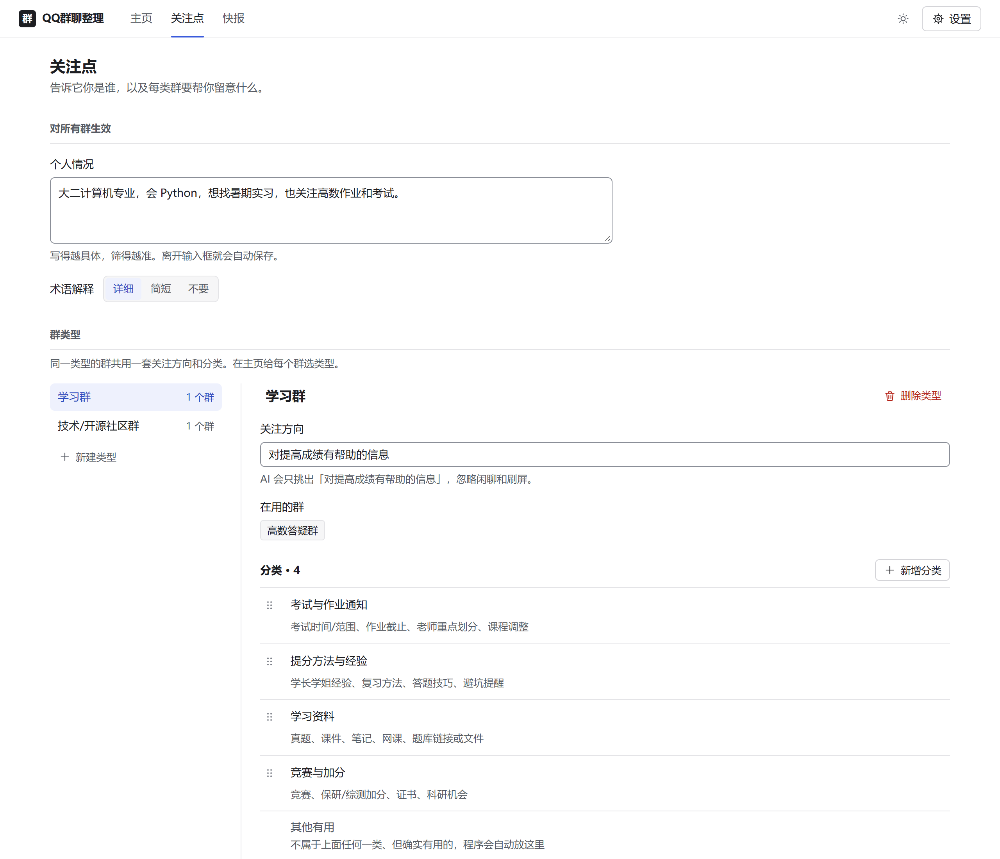
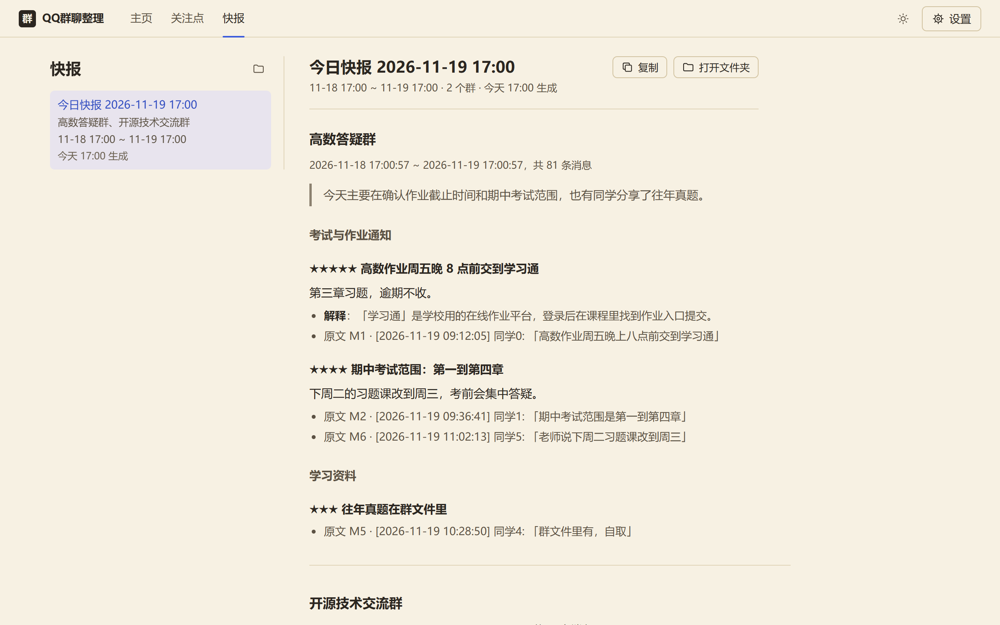

# Usage guide

**English** · [简体中文](usage.zh-CN.md) · [Back to README](../README.md)

- [Export chat records](#export-chat-records)
- [Desktop app](#desktop-app)
- [Command line](#command-line)
- [Configuration](#configuration)
- [Supported formats](#supported-formats)
- [Messages you may see](#messages-you-may-see)

## Export chat records

This project **only processes chats that have already been exported**. Use any export tool, for example the third-party [qq-chat-exporter](https://github.com/Yosooiiii/qq-chat-exporter) (by Yosooiiii, MIT, not affiliated with this project; assess its risks yourself). Choose **CSV**, which includes sender nicknames, and keep QQ running and signed in while exporting.

- Exports go to `Desktop\QQ聊天记录导出\` by default, with names like `群_<groupId>_<name>.csv`. If you export elsewhere, change it in settings (or `export_dir` in `config.json`)
- The tool finds files by group ID, takes the newest per format, and prefers CSV within the same export
- **Finding the group ID**: in the QQ group chat, open the group settings; the number under the group name is the ID. It's also in the export file name
- **Re-export before every run**; the tool never pulls new messages from QQ by itself

> Only export chats from your own account that you are entitled to view. Third-party tools are maintained by their own authors; this project is not responsible for them.

## Desktop app

On first launch, enter the AI endpoint, model and API key in the setup panel; **测试连接** (test connection) checks them.

| To change | How |
|---|---|
| Which groups to process | Tick or untick on the home page; ticking a newly found group adds it; **⋯ → remove** drops one |
| A group's type | The drop-down at the right of each group |
| What to focus on | The **关注点** (focus) tab: your profile and jargon level; each group type's focus and categories, which you can create, rename, delete and drag to reorder |
| How far back to look | Right-hand panel: since last run / 24 hours / 7 days / all / custom; **保存为默认** (save as default) remembers it |
| Appearance | The button left of **设置** (settings) cycles light, sepia and dark |

| Focus tab | Digests tab |
|---|---|
|  |  |

- **Where files live**: `config.json`, `state.json` and the default `reports\` are next to the exe. To upgrade, copy them into the new version's folder
- **No separate window?** Without WebView2 the app opens in your browser. Install the [WebView2 Runtime](https://developer.microsoft.com/microsoft-edge/webview2/) to get the window
- **From source**: double-click `启动界面.bat`, or run `python desktop.py` after `pip install pywebview`

## Command line

Needs Python 3.8+ (on Windows, tick "Add python.exe to PATH"); no packages to install.

```bash
git clone https://github.com/Eutopia-Nan/qq-group-digest.git
cd qq-group-digest
python digest.py --file examples/study.csv --type study --all --dry-run   # self-check, no key needed
```

1. Copy `config.example.json` to `config.json` and fill in at least `deepseek.api_key`, `profile` (who you are and what you need; the more specific, the better) and `groups` (`id` group ID, `name` any label, `type` `study` or `opensource`). Syntax errors are reported with a line number; the usual causes are a trailing comma, Chinese quotes, or a `\` in a path (use `/` or `\\`)
2. Dry run first (no AI call, free): `python digest.py --dry-run`
3. Generate: on Windows double-click `1_今日快报_24小时.bat` / `2_今周快报_一周.bat`, or run `python digest.py --preset daily`

```bash
python digest.py                     # messages since the last run (24 hours on first run)
python digest.py --preset weekly     # last 7 days
python digest.py --hours 72          # last 3 days
python digest.py --group 123456789   # one group only
python digest.py --file chat.txt --type study   # any chat file
python digest.py --file chat.csv --encoding gb18030 --dry-run   # preview a GBK export
python digest.py --all               # whole history (can be expensive)
```

<details>
<summary><b>Let an AI agent set it up</b>: send this prompt to Claude Code, Codex, Cursor or another assistant that can run commands</summary>

```text
Please install and configure the open-source project qq-group-digest on this computer:
https://github.com/Eutopia-Nan/qq-group-digest

It reads QQ group chat files that I export myself, uses AI to pick out what's useful to me, and produces daily/weekly digests.
First read README.md, docs/usage.md and config.example.json in the repo, then follow the steps below.
Talk to me in my language, ask one question at a time, explain things plainly, and don't assume I can code.

[Steps]
1. Check that Python >= 3.8 is installed. If not, tell me how to install it (on Windows, tick "Add python.exe to PATH"). Don't install it silently for me.
2. Ask me which folder to put the project in, then download it or git clone it there.
3. Run the self-check: python digest.py --file examples/study.csv --type study --all --dry-run and confirm it works.
4. Copy config.example.json to config.json, then ask me about each item and fill it in:
   - AI provider: DeepSeek (needs an API key and a topped-up balance at platform.deepseek.com), another OpenAI-compatible endpoint, or a local model such as Ollama.
   - profile: ask about my role, major or year, skill level, and what I most want from these groups (exam notices, gigs, internships, tech news…). Write it up as one paragraph.
   - groups: which groups to process, and each group's ID and purpose.
   - topics: design categories for each group's purpose. Reuse the built-in study / opensource types where they fit; otherwise create a new type and confirm the categories with me.
   - explain_style: whether I want jargon explained, and in how much detail.
   - export_dir: where my exported chat files are.
   After every edit, verify that config.json is valid JSON.
5. In the export folder, check by file name (群_<groupId>_*.csv / *.txt) that every group has an export file, and tell me which are missing.
6. Run python digest.py --preset daily --dry-run and summarize the result for me in a sentence or two.
7. Tell me the daily routine: re-export the chats first, then double-click 1_今日快报_24小时.bat or 2_今周快报_一周.bat.

[Rules you must follow]
- Write the API key only into the local config.json. Never show it in full in your replies, and never commit or upload it anywhere. config.json is in .gitignore; keep it that way.
- This project only processes files that have already been exported. Do not read or decrypt QQ's databases or process memory yourself. Do not download, install or run any third-party export tool unless I explicitly agree. If I have no export files yet, just explain my options and their risks and let me decide.
- Do not open or repeat the contents of my chats. When checking export files, look only at file names, sizes and modification times.
- Real AI calls cost money. Until I explicitly agree, only run commands with --dry-run.
- Do not modify digest.py. If something fails, show me the exact error and your diagnosis first.
```

</details>

## Configuration

All settings live in `config.json`; most of them can be changed in the desktop app instead.

| Key | Description | Default |
|---|---|---|
| `deepseek.api_key` | Key for the endpoint; the official DeepSeek endpoint also accepts `DEEPSEEK_API_KEY` | usually required for cloud services |
| `deepseek.base_url` | Any OpenAI-compatible endpoint | `https://api.deepseek.com` |
| `deepseek.model` | Model name | `deepseek-flash` |
| `deepseek.json_mode` | Request JSON mode; set `false` for endpoints without `response_format` | `true` |
| `deepseek.chunk_chars` | Character limit per batch; lower it for small-context models | `40000` |
| `deepseek.max_tokens` | Output token limit per batch | `4096` |
| `profile` | Who you are and what you need | none |
| `explain_style` | How to explain jargon; `""` turns it off | beginner-friendly |
| `topics` | Group types with their focus and categories, see below | `study`, `opensource` |
| `groups` | Groups to process: `id`, `name`, `type` | required |
| `export_dir` | Folder holding the exported files | `Desktop/QQ聊天记录导出` |
| `report_dir` | Where digests go when no preset is used | `reports` |
| `presets` | Named time windows (`hours`), titles and folders | `daily` 24h, `weekly` 168h |
| `open_report` | Open the digest after a command-line run | `true` |
| `save_raw` | Keep the selected plaintext during normal runs (dry runs always do) | `false` |
| `ui_defaults` | Selection and time range saved by the desktop app's "save as default" | all groups, since last run |
| `ui_theme` | Desktop app appearance: `light` / `sepia` / `dark` | follows the system |

**Group types**: create them on the focus tab of the desktop app. To add one by hand, put an entry next to `study` and `opensource` in `topics`, then set a group's `type` to its key:

```json
"job": {
  "label": "求职交流群",
  "focus": "招聘、内推和求职经验",
  "categories": { "内推机会": "公司、岗位、截止时间、联系方式", "面经": "面试题目、流程、薪资" }
}
```

- `categories` is the full list; built-in categories are not merged back in. Omit it to use the built-in ones. A catch-all "其他有用" (other useful) category is added automatically
- Deleting a built-in type in the app writes `{"removed": true}`; after deleting `opensource`, pass `--type` with `--file` on the command line
- **Local Ollama**: `"base_url": "http://localhost:11434/v1"`, a downloaded model such as `qwen2.5`, and an empty `api_key`

<details>
<summary><b>Upgrading from 1.x</b></summary>

- Older versions merged your categories with the built-in ones. If you only listed the categories you added, copy the built-in ones you want to keep from `config.example.json`
- The first successful incremental run converts `state.json` to track individual messages and may include some recent messages again. `--hours`, `--preset` and `--all` leave incremental progress unchanged

</details>

## Supported formats

| Format | Example |
|---|---|
| CSV (recommended) | A time column (`时间`/`time`/`date`) and a content column (`内容`/`content`/`message`); a sender column is optional |
| One-line TXT | `[2026-11-17 14:03:00] Alice: text` |
| Classic QQ Message Manager TXT | `2026-11-17 14:03:00 Alice(123456)`, content on the next line |
| Other plain text | Use `--all` to process the whole file when timestamps can't be detected |

CSV can be comma, semicolon or Tab separated. Timestamps can be local date-times, ISO 8601 with an offset, or 10/13-digit Unix timestamps. UTF-8 and UTF-16 with a BOM are detected; for GBK exports pass `--encoding gb18030`.

## Messages you may see

| Message | Cause and fix |
|---|---|
| `'python' is not recognized` | Python isn't on PATH; re-run the installer, choose Modify and tick "Add python.exe to PATH" |
| `config.json 第 X 行格式有误` | JSON syntax error on that line |
| `没找到导出文件` (export not found) | Not exported yet, wrong `export_dir`, or wrong group ID |
| Newest message is older than the start of the window | The export is stale; re-export |
| `401` / `402` | Wrong API key / insufficient balance |
| `没有待处理的文本消息` (nothing to process) | No new messages in the window; re-export or try `--hours 72` |
| `没有筛出有用信息` (nothing useful found) | Everything was chatter; make your profile and categories more specific |

Known limitation: large inputs are split into batches, so an item spanning batches can appear twice. Git ignores `config.json`, `state.json`, `reports/` and `raw/`; if you use a custom report folder, check it before sharing the repository.
