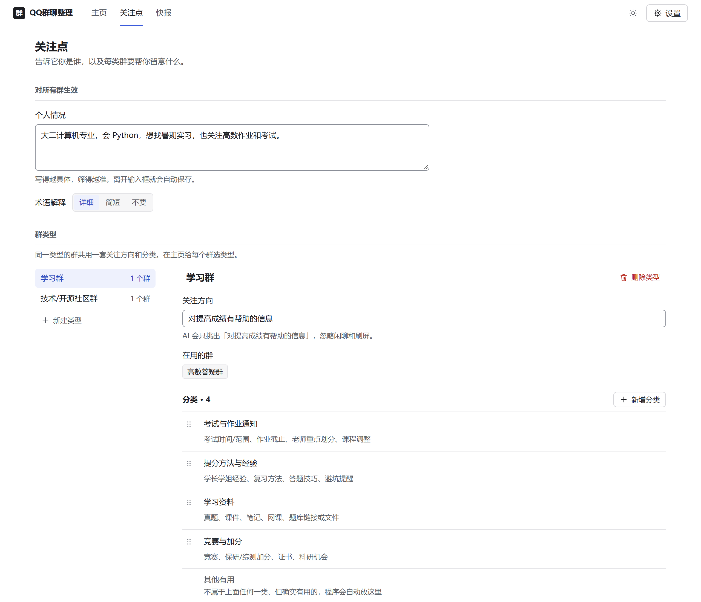
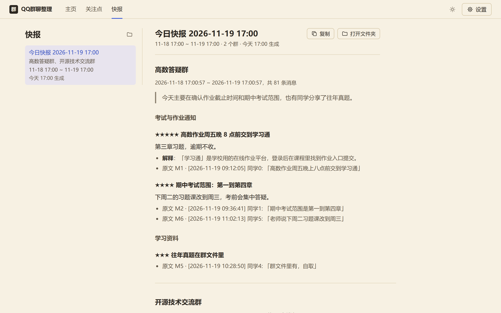

# 使用说明

[English](usage.md) · **简体中文** · [返回 README](../README.zh-CN.md)

- [导出群聊记录](#导出群聊记录)
- [图形界面](#图形界面)
- [命令行版](#命令行版)
- [配置](#配置)
- [支持的聊天记录格式](#支持的聊天记录格式)
- [运行时的提示](#运行时的提示)

## 导出群聊记录

本项目**只处理已经导出的文件**。可以用任何导出工具，例如第三方的 [qq-chat-exporter](https://github.com/Yosooiiii/qq-chat-exporter)（作者 Yosooiiii，MIT 许可，与本项目无关，请自行评估风险）。导出时选 **CSV**，里面带发言人昵称；导出时 QQ 需要运行并登录。

- 默认导出到 `桌面\QQ聊天记录导出\`，文件名形如 `群_<群号>_<群名>.csv`。位置不同的话，在设置（或 `config.json` 的 `export_dir`）里改
- 程序按群号找文件，同一格式取最新的；同一批导出优先用 CSV
- **群号在哪看**：QQ 群聊 → 右上角「群聊设置」，群名下面那串数字；导出的文件名里也有
- **每次生成前先重新导出**，程序不会自己从 QQ 拉取新消息

> 请仅导出你本人账号、你有权查看的聊天记录。文中提到的第三方工具由各自作者维护，本项目不对其负责。

## 图形界面

第一次打开会弹出首次设置：填 AI 接口地址、模型和 API Key，可以先点 **测试连接**。

| 想做的事 | 怎么做 |
|---|---|
| 换要整理的群 | 主页勾选或取消；新发现的群勾选就会添加；不要的群点 **⋯ → 从列表移除** |
| 改群的类型 | 主页每个群右边的下拉框 |
| 改关注的信息 | **关注点** 页：个人情况、术语解释程度；群类型的关注方向和分类，可新建、改名、删除、拖动排序 |
| 改回溯时间 | 主页右侧：上次之后 / 24 小时 / 7 天 / 全部 / 自定义；**保存为默认** 下次自动选好 |
| 换外观 | 顶栏「设置」左边的按钮，在白、米黄、黑之间切换 |

| 关注点页 | 快报页 |
|---|---|
|  |  |

- **文件位置**：`config.json`、`state.json` 和默认的 `reports\` 都在 exe 所在的文件夹。升级时把它们复制到新版本的文件夹即可
- **没有独立窗口**：缺少 WebView2 时会改用浏览器打开。可以安装 [WebView2 运行时](https://developer.microsoft.com/microsoft-edge/webview2/)
- **从源码运行界面**：双击 `启动界面.bat`；装了 `pywebview` 的话运行 `python desktop.py` 打开独立窗口

## 命令行版

需要 Python 3.8+（Windows 安装时勾选 "Add python.exe to PATH"），不需要安装依赖。

```bash
git clone https://github.com/Eutopia-Nan/qq-group-digest.git
cd qq-group-digest
python digest.py --file examples/study.csv --type study --all --dry-run   # 自检，不需要 Key
```

1. 复制 `config.example.json` 为 `config.json`，至少填好 `deepseek.api_key`、`profile`（你的情况，越具体越准）和 `groups`（`id` 群号、`name` 群名、`type` 填 `study` 或 `opensource`）。写错了程序会提示第几行；常见原因是多了逗号、用了中文引号、路径里的 `\` 没写成 `\\` 或 `/`
2. 先试运行（不调用 AI、不花钱）：`python digest.py --dry-run`
3. 生成快报：Windows 双击 `1_今日快报_24小时.bat` / `2_今周快报_一周.bat`，或运行 `python digest.py --preset daily`

```bash
python digest.py                     # 增量处理上次之后的消息，首次回看 24 小时
python digest.py --preset weekly     # 最近 7 天
python digest.py --hours 72          # 最近 3 天
python digest.py --group 123456789   # 只处理一个群
python digest.py --file 文件.txt --type study    # 处理任意一个文件
python digest.py --file 文件.csv --encoding gb18030 --dry-run   # 预览 GBK 导出
python digest.py --all               # 全部历史（很费钱，慎用）
```

<details>
<summary><b>让 AI Agent 帮你配置</b>：把这段提示词发给 Claude Code、Codex、Cursor 等能执行命令的助手</summary>

```text
请帮我在这台电脑上安装并配置开源项目 qq-group-digest：
https://github.com/Eutopia-Nan/qq-group-digest

它会读取我自己导出的 QQ 群聊记录文件，用 AI 筛选出对我有用的信息，生成每日/每周快报。
请先阅读仓库里的 README.zh-CN.md、docs/usage.zh-CN.md 和 config.example.json，再按下面的步骤操作。
请用我的语言和我交流，每次只问一个问题，用通俗的话解释，不要假设我懂编程。

【步骤】
1. 检查 Python 版本是否 >= 3.8。没有的话，告诉我怎么安装（Windows 要勾选 "Add python.exe to PATH"），不要替我静默安装。
2. 问我想把项目放在哪个文件夹，然后下载或 git clone 到那里。
3. 运行自检：python digest.py --file examples/study.csv --type study --all --dry-run ，确认能正常运行。
4. 复制 config.example.json 为 config.json，然后逐项问我并填写：
   - AI 服务：用 DeepSeek（需要 API Key，要先在 platform.deepseek.com 充值），还是其他 OpenAI 兼容接口或本地模型（如 Ollama）。
   - profile：问我的身份、专业或年级、能力水平、最想从群里得到什么（比如考试通知、兼职、实习、技术动态），整理成一段话。
   - groups：问我要筛选哪些群，以及每个群的群号和用途。
   - topics：根据每个群的用途，帮我设计分类。能用现成的 study / opensource 就直接用；不合适就新建类型，并和我确认分类。
   - explain_style：问我需不需要术语解释、解释到什么程度。
   - export_dir：问我导出的聊天记录放在哪里。
   每次修改后都要验证 config.json 是合法的 JSON。
5. 在导出文件夹里，按文件名（群_<群号>_*.csv / *.txt）确认每个群都有导出文件，并告诉我缺哪些。
6. 运行 python digest.py --preset daily --dry-run ，把结果用一两句话告诉我。
7. 告诉我日常怎么用：先重新导出聊天记录，再双击 1_今日快报_24小时.bat 或 2_今周快报_一周.bat。

【必须遵守】
- API Key 只写进本地的 config.json，不要在回复里完整显示，也不要提交或上传到任何地方。config.json 已在 .gitignore 里，不要改动这一点。
- 本项目只处理已经导出的文件。不要自己去读取、解密 QQ 的数据库或进程内存。也不要在我没有明确同意的情况下下载、安装或运行任何第三方导出工具。如果我还没有导出文件，只需告诉我有哪些选择和各自的风险，由我决定。
- 不要打开或复述我的聊天记录内容。确认导出文件时只看文件名、大小、修改时间。
- 真正调用 AI 会产生费用。在我明确同意之前，只运行带 --dry-run 的命令。
- 不要修改 digest.py。遇到报错，先把报错原文和你的判断告诉我。
```

</details>

## 配置

所有设置都在 `config.json` 里，图形界面能改的大多不用手动编辑。

| 字段 | 说明 | 默认值 |
|---|---|---|
| `deepseek.api_key` | AI 接口的 Key，官方 DeepSeek 也可用环境变量 `DEEPSEEK_API_KEY` | 云端服务通常需要 |
| `deepseek.base_url` | 任何 OpenAI 兼容接口 | `https://api.deepseek.com` |
| `deepseek.model` | 模型名 | `deepseek-flash` |
| `deepseek.json_mode` | 要求接口启用 JSON 模式；不支持 `response_format` 的接口设为 `false` | `true` |
| `deepseek.chunk_chars` | 每批消息的字符上限，小上下文模型可调低 | `40000` |
| `deepseek.max_tokens` | 每批输出的 token 上限 | `4096` |
| `profile` | 你的身份、能力和需求 | 无 |
| `explain_style` | 术语解释风格，`""` 表示不解释 | 面向零基础 |
| `topics` | 群类型及其关注点和分类，见下文 | `study`、`opensource` |
| `groups` | 要筛选的群：`id`、`name`、`type` | 必填 |
| `export_dir` | 导出文件所在的文件夹 | `桌面\QQ聊天记录导出` |
| `report_dir` | 不用预设时快报的保存位置 | `reports` |
| `presets` | 预设的时间范围（`hours`）、标题和保存位置 | `daily` 24 小时、`weekly` 168 小时 |
| `open_report` | 命令行运行完是否自动打开快报 | `true` |
| `save_raw` | 正式运行时是否保留筛选后的原文（试运行总会保留） | `false` |
| `ui_defaults` | 图形界面「保存为默认」写入的勾选和时间范围 | 全部群、上次之后 |
| `ui_theme` | 图形界面外观：`light` / `sepia` / `dark` | 跟随系统 |

**群类型**：在图形界面的 **关注点** 页新建即可。手动添加时，在 `topics` 里和 `study`、`opensource` 并列加一项，再把群的 `type` 写成它的键：

```json
"job": {
  "label": "求职交流群",
  "focus": "招聘、内推和求职经验",
  "categories": { "内推机会": "公司、岗位、截止时间、联系方式", "面经": "面试题目、流程、薪资" }
}
```

- `categories` 以你写的为准，不会再合并内置分类；不写时沿用内置分类。程序会自动加一个「其他有用」分类
- 在界面删除内置类型会写入 `{"removed": true}`；删除 `opensource` 后，命令行 `--file` 需要加 `--type`
- **换成本机 Ollama**：`"base_url": "http://localhost:11434/v1"`，`model` 填已下载的模型名（如 `qwen2.5`），清空 `api_key`

<details>
<summary><b>从 1.x 升级的注意事项</b></summary>

- 旧版会把你写的分类和内置分类合并。如果你以前只写了新增的分类，升级后需要把想保留的内置分类补写回去（可从 `config.example.json` 复制）
- 旧 `state.json` 会在首次成功生成增量快报时转为消息级记录，这一次可能再次收录部分近期消息。`--hours`、`--preset` 和 `--all` 不更新增量进度

</details>

## 支持的聊天记录格式

| 格式 | 示例 |
|---|---|
| CSV（推荐） | 表头含时间列（`时间`/`日期`/`time`/`date`）和内容列（`内容`/`消息`/`content`/`message`），发送者列可选 |
| 单行 TXT | `[2026-11-17 14:03:00] 张三: 内容` |
| 经典版 QQ 消息管理器 TXT | `2026-11-17 14:03:00 张三(123456)`，下一行是内容 |
| 其他纯文本 | 无法识别时间时，用 `--all` 处理整份文件 |

CSV 支持逗号、分号和 Tab 分隔；时间可以是本地时间、带时区的 ISO 8601 或 10/13 位时间戳；默认识别 UTF-8 和带 BOM 的 UTF-16，GBK 导出加 `--encoding gb18030`。

## 运行时的提示

| 提示 | 原因和解决方法 |
|---|---|
| `'python' 不是内部或外部命令` | Python 没加入 PATH，重新运行安装程序，选 Modify 并勾选 "Add python.exe to PATH" |
| `config.json 第 X 行格式有误` | 那一行 JSON 写错了 |
| `没找到导出文件` | 还没导出、`export_dir` 不对，或群号填错 |
| 最新消息比筛选起点还早 | 导出文件太旧，先重新导出 |
| `401` / `402` | API Key 错误 / 余额不足 |
| `没有待处理的文本消息` | 这段时间没有新消息，可重新导出或试试 `--hours 72` |
| `没有筛出有用信息` | 都是闲聊；把个人情况和分类写得更具体 |

已知限制：消息很多时会分批处理，同一件事跨批次时可能出现两次。Git 默认忽略 `config.json`、`state.json`、`reports/` 和 `raw/`；自定义了报告目录的话，分享仓库前也检查一下。
